  

  
  
  

**Building with intent. Learning with curiosity.**

---

## ABOUT ME

I'm **Berwin C R**, an Information Technology undergraduate at the **College of Engineering, Guindy (CEG), Anna University**.

I enjoy turning ideas into useful software, understanding how systems work, and constantly improving my problem-solving skills.

My primary interest is **Software Engineering and Full-Stack Development**, while exploring **Artificial Intelligence, Machine Learning, and Data Science**.

<table>
<tr>
<td width="50%">

**EDUCATION**

B.Tech Information Technology

College of Engineering, Guindy

CGPA: **9.56 / 10**

</td>
<td width="50%">

**AREAS OF INTEREST**

- Software Engineering
- Full-Stack Development
- Artificial Intelligence
- Machine Learning
- Data Science

</td>
</tr>
</table>

---

## FEATURED PROJECTS

<table>
<tr>
<td width="50%" valign="top">

### 01. MediGuide AI

**AI · Healthcare**

An AI-powered healthcare education assistant that helps users explore health information, track symptoms, and access medicine-related information.

**Tech Stack**

`React` `FastAPI` `MongoDB` `Gemini` `JWT` `Tesseract OCR`

[VIEW PROJECT ↗](https://github.com/berwincr/MediGuide_AI)

</td>
<td width="50%" valign="top">

### 02. Ledger

**Full Stack · Finance**

A personal expense tracker for managing income and expenses, viewing transactions, and understanding spending patterns through interactive charts.

**Tech Stack**

`React` `Node.js` `Express` `MongoDB` `JWT` `Chart.js`

[VIEW PROJECT ↗](https://github.com/berwincr/ledger)

[LIVE DEMO ↗](https://expense-tracker-nine-rho-67.vercel.app)

</td>
</tr>
<tr>
<td width="50%" valign="top">

### 03. PharmaLens

**AI · Medicine Discovery**

An AI-powered medicine information and pharmacy discovery agent using a ReAct-style architecture and external information tools.

**Tech Stack**

`Python` `FastAPI` `OpenRouter` `RxNorm` `MedlinePlus` `Tavily`

[VIEW PROJECT ↗](https://github.com/berwincr/PharmaLens)

</td>
<td width="50%" valign="top">

### 04. ShowTime

**Web Development · Booking**

A movie-ticket booking application with movie discovery, showtime selection, seat booking, and payment integration in test mode.

**Tech Stack**

`React` `Java` `Spring Boot` `MySQL` `TMDB` `Razorpay`

[VIEW PROJECT ↗](https://github.com/berwincr/ShowTime)

</td>
</tr>
<tr>
<td width="50%" valign="top">

### 05. Vidhai

**Web Development · Seed Bank**

A seed-bank management application for maintaining seed inventory and managing seed information.

**Tech Stack**

`HTML` `CSS` `JavaScript` `Node.js` `MySQL`

[VIEW PROJECT ↗](https://github.com/berwincr/Vidhai)

</td>
<td width="50%" valign="top">

### 06. LeetCode Solutions

**Problem Solving · DSA**

A growing collection of C++ solutions covering data structures, algorithms, and competitive programming problems.

**Tech Stack**

`C++` `Data Structures` `Algorithms`

[VIEW REPOSITORY ↗](https://github.com/berwincr/leetcode_solutions)

[LEETCODE PROFILE ↗](https://leetcode.com/u/Berwin_cr/)

</td>
</tr>
</table>

---

## TECHNICAL TOOLKIT

### Programming Languages

### Frontend Development

### Backend & Databases

### Tools & Technologies

---

## CAMPUS & COMMUNITY

**CEG TechForum** — Event Coordinator

**National Service Scheme (NSS)** — Volunteer

I enjoy collaborating with others, learning from new experiences, and contributing to the campus community.

---

## GITHUB CONTRIBUTIONS

 

[Explore my GitHub activity](https://github.com/berwincr)

---

## LET'S CONNECT

  

**Open to learning, building, and meaningful collaborations.**

*Stay curious. Keep building.*

  

